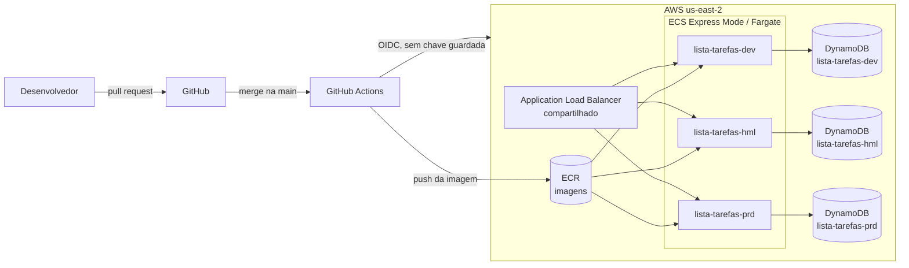
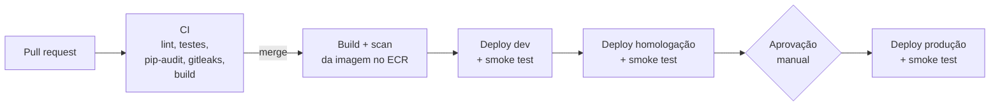

# Lista de tarefas com CI/CD na AWS

Aplicação web simples (adicionar e remover tarefas) com banco de dados **Amazon DynamoDB**, publicada em três ambientes na AWS (**desenvolvimento**, **homologação** e **produção**) por um pipeline de **CI/CD no GitHub Actions**.

O foco do projeto é o pipeline: testes, verificações de segurança, uma única imagem promovida de ambiente em ambiente, aprovação manual para produção, smoke test após cada deploy e rollback.

## Arquitetura



Cada ambiente tem seu próprio serviço, sua própria tabela e sua própria role: o dev não consegue ler nem apagar dados de produção. Os três serviços compartilham um único load balancer, o que reduz o custo.

## Fluxo do pipeline



| Etapa | O que faz |
|---|---|
| **CI** (todo pull request) | `ruff` (lint e formatação), `pytest` (API e DynamoDB simulado com `moto`), `pip-audit` (vulnerabilidades nas bibliotecas), `gitleaks` (senhas esquecidas no código), build e teste rápido do contêiner |
| **Build e scan** | Monta a imagem **uma vez**, marcada com o commit, envia ao ECR e bloqueia o deploy se o scan do ECR achar vulnerabilidade crítica |
| **Deploy** | Marca a imagem com a tag do ambiente (`dev`, `hml`, `prd`), atualiza o serviço no ECS e espera estabilizar |
| **Smoke test** | Chama o `/health` até responder com a versão nova e confere se o banco responde |
| **Produção** | Só roda depois da aprovação no GitHub (environment `producao` com revisor obrigatório) |
| **Rollback** | Workflow manual que publica a imagem de qualquer commit anterior em qualquer ambiente |

Se um ambiente estiver desligado, o pipeline apenas marca a imagem e segue. Quando o ambiente for ligado, ele sobe já com a versão certa.

## Estrutura

```
app/                  aplicação (FastAPI) e página web
tests/                testes automáticos
infra/setup.ps1       configuração inicial na AWS e no GitHub (rodar uma vez)
infra/ambientes.ps1   ligar, desligar e ver o status dos ambientes
.github/workflows/    ci.yml, pipeline.yml, deploy.yml, rollback.yml
Dockerfile
```

## Endpoints

| Rota | Descrição |
|---|---|
| `GET /` | Página com a lista e a faixa do ambiente |
| `GET /api/itens` | Lista as tarefas |
| `POST /api/itens` | Adiciona (`{"texto": "..."}`) |
| `DELETE /api/itens/{id}` | Remove |
| `GET /health` | Status, ambiente e versão (commit) no ar |

## Como usar

### Rodar no computador

Sem a variável `TABLE_NAME`, a aplicação guarda os dados na memória, então não precisa de AWS:

```powershell
docker build -t lista-tarefas .
docker run --rm -p 8000:8000 lista-tarefas
```

Abra `http://localhost:8000`.

### Configuração inicial (uma vez)

Pré-requisitos: AWS CLI configurado, GitHub CLI logado (`gh auth login`) e o repositório clonado.

```powershell
Set-ExecutionPolicy -Scope Process Bypass
.\infra\setup.ps1
```

O script cria o repositório no ECR, as tabelas, as roles, a ligação OIDC entre GitHub e AWS, e configura no GitHub as variáveis, os environments e a regra de proteção da `main`.

Em seguida, rode o pipeline uma vez em **Actions > Pipeline > Run workflow** para gerar a primeira imagem, e ligue os ambientes:

```powershell
.\infra\ambientes.ps1 -Acao ligar -Ambiente dev
.\infra\ambientes.ps1 -Acao status
```

### Dia a dia

```powershell
git checkout -b minha-mudanca
# ... editar o código ...
git add .
git commit -m "Descreve a mudanca"
git push -u origin minha-mudanca
gh pr create --fill
```

O CI roda no pull request. Depois do merge, o pipeline publica em dev e homologação, e espera a sua aprovação para produção (em **Actions**, botão **Review deployments**).

### Rollback

Em **Actions > Rollback > Run workflow**, escolha o ambiente e informe o commit (40 caracteres) da versão desejada.

### Ligar e desligar ambientes

```powershell
.\infra\ambientes.ps1 -Acao ligar -Ambiente todos
.\infra\ambientes.ps1 -Acao desligar -Ambiente hml
```

Desligar apaga apenas o serviço (para de cobrar). A tabela com os dados, as imagens e as roles continuam. Ao ligar de novo, o endereço público muda, e o script atualiza a variável `APP_URL` no GitHub.

## Custos

Cada ambiente ligado roda um contêiner pequeno (0,25 vCPU e 0,5 GB). Os três compartilham um load balancer. O DynamoDB cobra por uso e, para este volume, fica praticamente em zero. Desligue os ambientes quando não estiver usando.

## Próximos passos

- Infraestrutura como código (Terraform) no lugar dos scripts
- Alertas de custo (AWS Budgets) e alarmes no CloudWatch
- Ambientes temporários por pull request
- Domínio próprio com HTTPS
